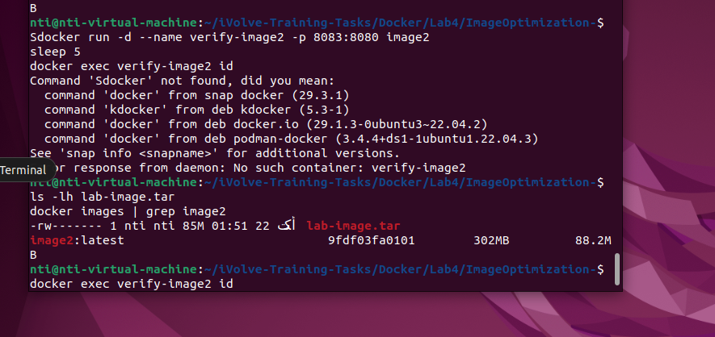

# Docker Lab 4 - Image Optimization

## Overview
This lab focuses on optimizing a Docker image using a multi-stage build.

## Optimization Techniques
- Used a multi-stage Docker build.
- Separated the build environment from the runtime environment.
- Used a lightweight Java JRE image.
- Created a non-root user to run the application.

## Results
- Original image size: 671 MB
- Optimized image size: 302 MB
- Image size reduction: approximately 55%

## Screenshot

