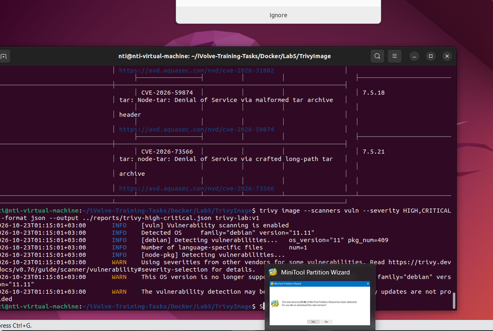

# Lab 5: Trivy Image Vulnerability Scanning

## Objective
Scan a Docker image using Trivy to identify security vulnerabilities.

## Docker Image
`trivy-lab:v1`

## Scan Command
```bash
trivy image --scanners vuln --severity HIGH,CRITICAL trivy-lab:v1

```

## Screenshot



## Notes
The scan identifies vulnerabilities that should be reviewed and remediated.
