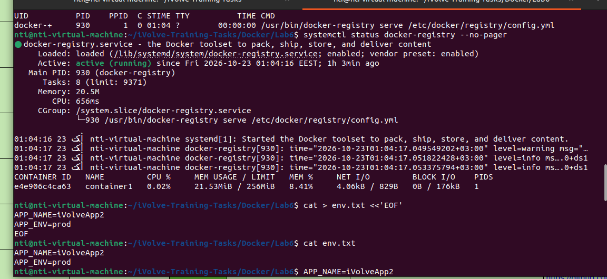

# Lab 6: Docker Environment Variables and Resource Management

## Objective
Build and run a Flask application using Docker environment variables and resource limits.

## Files
- `Dockerfile`: Builds the `ivolve1` image.
- `Dockerfile.dev`: Builds the `ivolve3` image with default environment variables.
- `env.txt`: Defines environment variables for the env-file test.
- `PythonApp/app.py`: Flask application.
- `PythonApp/requirements.txt`: Python dependencies.

## Step 1: Build the initial image
```bash
docker build -t ivolve1 .
```

## Step 2: Run with environment variables and resource limits
docker run -d --name container1 -p 5000:5000 -e APP_NAME=iVolveApp1 -e APP_ENV=stg --cpus="1" --memory="256m" ivolve1

## Step 3: Verify environment variables
docker exec container1 printenv APP_NAME APP_ENV

## Step 4: Monitor resource usage
docker stats container1

## Step 5: Run with an environment file
docker run -d --name container2 -p 5001:5000 --env-file env.txt ivolve1

## Step 6: Build and run the development image
docker build -t ivolve3 -f Dockerfile.dev .
docker run -d --name container2 -p 5000:5000 ivolve3

## Step 7: Test the application
curl http://localhost:5000

Expected final values:
- APP_NAME=iVolveApp3
- APP_ENV=dev
  
## Screenshot

