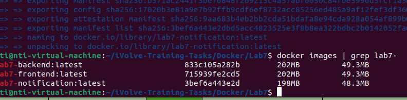
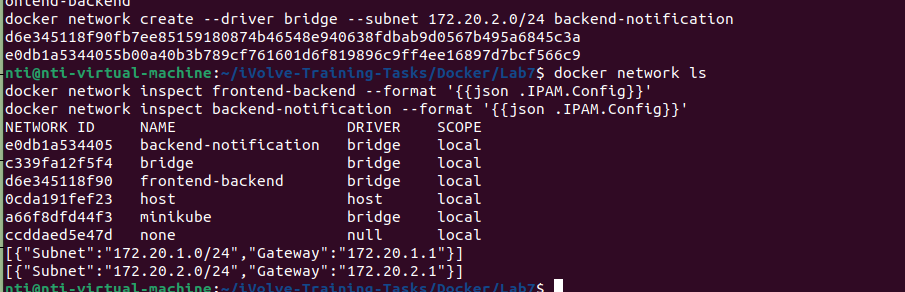
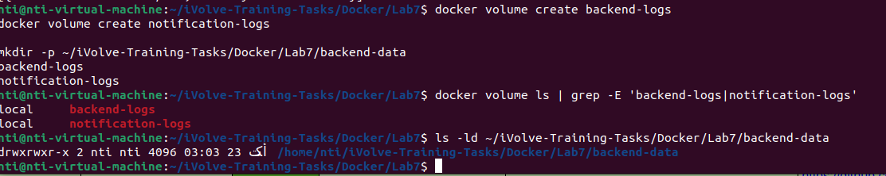
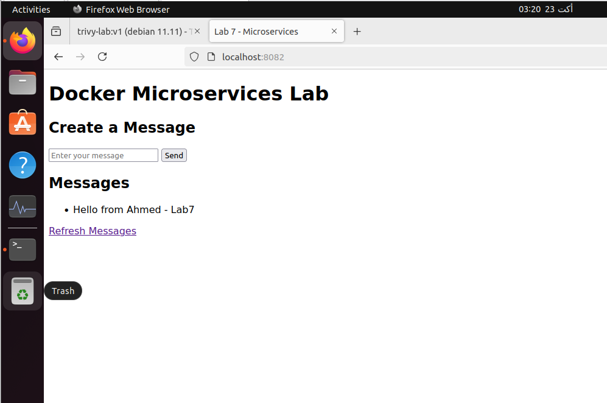
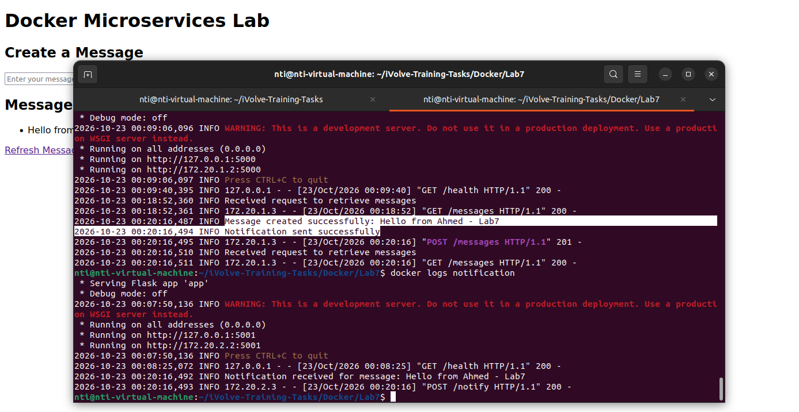
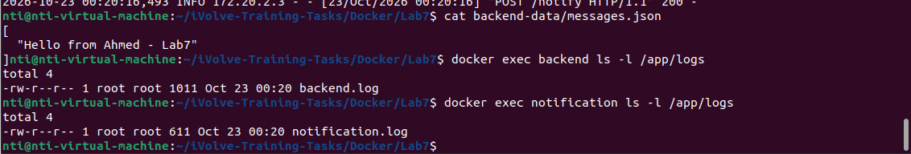
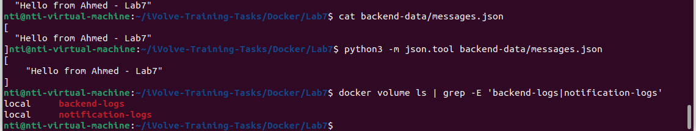

# Lab 7: Multi-Network Microservices, Volumes, and Bind Mounts

## Objective
Deploy a Flask-based microservices application using Docker containers, custom bridge networks, Docker volumes, and a host bind mount.

## Architecture
The application consists of three services:

- **Frontend:** Web interface running on container port 3000.
- **Backend:** REST API running on container port 5000.
- **Notification:** Receives notification requests on container port 5001.

Communication flow:

Frontend -> Backend -> Notification

## Docker Images

| Service | Image | Container Port |
|---|---|---|
| Frontend | lab7-frontend | 3000 |
| Backend | lab7-backend | 5000 |
| Notification | lab7-notification | 5001 |

## Networks

Two custom bridge networks isolate service communication.

| Network | Subnet | Connected Services |
|---|---|---|
| frontend-backend | 172.20.1.0/24 | Frontend, Backend |
| backend-notification | 172.20.2.0/24 | Backend, Notification |

The backend is connected to both networks so it can communicate with the frontend and notification services.

## Storage

- `backend-logs`: Docker volume mounted at `/app/logs` in the backend.
- `notification-logs`: Docker volume mounted at `/app/logs` in the notification service.
- `backend-data`: Host directory mounted at `/app/data` in the backend to persist `messages.json`.

## Build Images

Run these commands from the Lab7 directory:

```bash
docker build -t lab7-frontend ./MicroserviceApp/frontend
docker build -t lab7-backend ./MicroserviceApp/backend
docker build -t lab7-notification ./MicroserviceApp/notification
```

## Create Networks and Volumes

```bash
docker network create --driver bridge --subnet 172.20.1.0/24 frontend-backend
docker network create --driver bridge --subnet 172.20.2.0/24 backend-notification

docker volume create backend-logs
docker volume create notification-logs

mkdir -p backend-data
```

## Run the Services

Start the notification service:

```bash
docker run -d \
  --name notification \
  --network backend-notification \
  --network-alias notification \
  --mount source=notification-logs,target=/app/logs \
  lab7-notification
```

Start the backend on the frontend-backend network with a bind mount and log volume:

```bash
docker run -d \
  --name backend \
  --network frontend-backend \
  --mount type=bind,source="$PWD/backend-data",target=/app/data \
  --mount source=backend-logs,target=/app/logs \
  -e NOTIFICATION_URL=http://notification:5001/notify \
  lab7-backend
```

Connect the backend to the notification network:

```bash
docker network connect backend-notification backend
```

Start the frontend:

```bash
docker run -d \
  --name frontend \
  --network frontend-backend \
  -p 8082:3000 \
  -e BACKEND_URL=http://backend:5000 \
  lab7-frontend
```

**Port note:** Port 8082 was used in the test environment because host ports 8080 and 8081 were already occupied. If port 8080 is available, use `-p 8080:3000` instead.

## Verification

Check running containers:

```bash
docker ps
```

Check network configuration:

```bash
docker network inspect frontend-backend
docker network inspect backend-notification
```

Check the backend and notification health endpoints from inside their containers:

```bash
docker exec backend python -c "import urllib.request; print(urllib.request.urlopen('http://localhost:5000/health').read().decode())"

docker exec notification python -c "import urllib.request; print(urllib.request.urlopen('http://localhost:5001/health').read().decode())"
```

Open the frontend in a browser:

```text
http://localhost:8082
```

Create a message through the web interface and confirm that it appears in the messages list.

Inspect service logs:

```bash
docker logs backend
docker logs notification
```

Verify persisted message data and log files:

```bash
python3 -m json.tool backend-data/messages.json
docker exec backend ls -l /app/logs
docker exec notification ls -l /app/logs
docker volume ls
```

## Test Results

- All three service containers were running.
- Frontend requests successfully reached the backend.
- The backend created and returned messages.
- The backend successfully sent notification requests.
- The notification service received the test message.
- The backend message file was available through the host bind mount.
- Backend and notification log files were created in their Docker volumes.

## Cleanup

To remove the containers created for this lab:

```bash
docker rm -f frontend backend notification
```

Remove the networks and volumes only when you no longer need their data:

```bash
docker network rm frontend-backend backend-notification
docker volume rm backend-logs notification-logs
```

The host-side `backend-data` directory is not removed by these commands.

## Screenshots

### Docker Images


### Docker Networks


### Volumes and Bind Mount


### Notification Health Check


### Backend Networks


### Message Flow


### Microservices Running


### Notification Flow


### Persistent Logs


### Storage Verification

